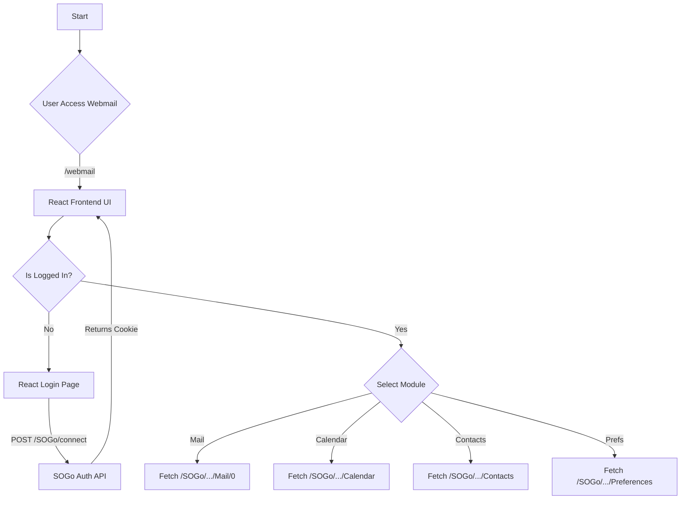

# 01. Product Requirements Document (PRD)
- **Tanggal:** 20 Juli 2026
- **PM/Manager:** Anas Fikri
- **Tujuan Bisnis & Scope:** Membangun *frontend* webmail baru untuk menggantikan antarmuka default SOGo di Mailcow. Fokus utama adalah menciptakan antarmuka yang sangat bersih (*clean*), nyaman (*user-friendly*), dan mengusung desain *Mobile-First App-like*. Sistem ini **tidak boleh menggunakan data *mock***, melainkan harus memiliki fungsionalitas 100% *real-time* yang terhubung ke API SOGo.

## Comprehensive Feature Map (SOGo Modul)
Berdasarkan hasil *audit* langsung ke dalam sistem SOGo Mailcow, *frontend* baru ini harus mendukung 4 pilar fitur utama:

### 1. Modul Mailer (Email)
- **Mailboxes:** Memuat daftar folder (Inbox, Sent, Trash, Junk, Drafts, custom folder).
- **Mailbox / Thread:** Menampilkan daftar email dalam folder beserta paginasi, pencarian, dan *sorting*.
- **Message Reader:** Membaca isi email (HTML/Text), merender *MIME multipart*, mengelola lampiran (*attachments*), gambar *inline*, serta fungsi balas/teruskan.
- **Message Editor (Compose):** Editor *Rich Text*, sistem *draft* otomatis, pengelolaan CC/BCC, lampiran *file* *upload*, dan validasi email tujuan.

### 2. Modul Scheduler (Kalender)
- **Calendars:** Menampilkan kalender pribadi & kalender yang dibagikan.
- **Calendar View:** Render *grid* kalender (Harian, Mingguan, Bulanan).
- **Component Editor:** Membuat/mengedit *event*, mengatur jadwal berulang (*recurring*), mengundang partisipan, serta RSVP (*Accept/Decline*).

### 3. Modul Contacts (Buku Alamat)
- **Address Books:** Mengelola buku alamat pribadi (Personal) dan global (Global Address Book).
- **Cards:** Membuat kontak baru, edit info kontak, serta *import/export* vCard.

### 4. Modul Preferences (Pengaturan)
- **Account Dialog:** Mengganti *password*, mengatur identitas pengirim (Nama, *Signature*).
- **Filters & Auto-Reply:** Mengelola Sieve Filters (pindah folder otomatis) dan sistem *Vacation* (Balasan Otomatis).
- **ACL:** Mengatur delegasi/pembagian hak akses folder email ke akun lain.

## User Stories & Acceptance Criteria
- [ ] User dapat login dan langsung melihat 4 navigasi utama (Mail, Calendar, Contacts, Settings) yang berfungsi tanpa data statis/mock.
- [ ] Proses *fetch* email harus mem-parsing *attachment* dengan benar dan aman untuk didownload.
- [ ] Tampilan harus 100% responsif (berubah layaknya *mobile app* ketika dibuka di *smartphone*).

## Business Flow (Mermaid)

