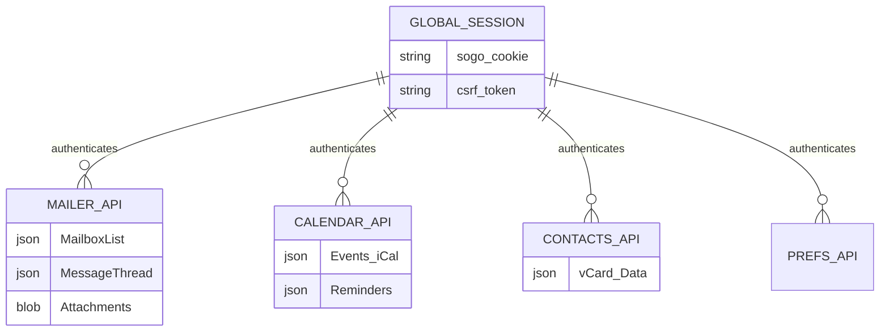

# 02. Architecture Requirements Document (ARD)
## 1. System Architecture & Tech Stack
Proyek ini mengusung arsitektur *Single Page Application* (SPA) berskala besar dengan tumpukan teknologi modern:
- **Core Framework:** React 18+ (dengan Vite).
- **State Management:** *Zustand* (untuk menyimpan statu sesi global seperti menu terpilih, informasi profil akun, jumlah email belum dibaca).
- **Data Fetching:** *TanStack React Query* (Sangat krusial untuk otomatisasi *caching*, *polling* kotak masuk secara latar belakang, dan sinkronisasi data dengan SOGo API).
- **UI & Styling:** Tailwind CSS v4 dikombinasikan dengan komponen *Headless* (Shadcn/UI atau Radix UI) untuk aksesibilitas dan animasi (Framer Motion).
- **Backend/Middleware:** Tidak ada. Murni interaksi REST API langsung dari React ke Nginx SOGo Endpoint.

## 2. Entity Relationship Diagram (ERD) & API Topology
*Sistem mengelola relasi 4 modul dengan 1 sistem sesi global (SOGo Web Cookie).*

## 3. SOGo API Contracts (Reverse-Engineered Blueprint)
Berikut adalah kerangka struktur API SOGo yang akan dipanggil oleh React Query:

### 3.1. Authentication (Core)
- **URL:** `POST /SOGo/connect`
- **Payload:** `{"userName":"user@domain", "password":"xxx"}`
- **Response:** Mengatur cookie `sogo-web` di browser. Gagal jika `LDAPPasswordPolicyError` dikembalikan.

### 3.2. Mailer Module API (Draft)
- **Fetch Folder:** `GET /SOGo/so/{userName}/Mail/0/` -> *Mengembalikan JSON hirarki folder.*
- **Fetch Inbox:** `GET /SOGo/so/{userName}/Mail/0/folderInbox/view` -> *Mengembalikan daftar email.*
- **Read Mail:** `GET /SOGo/so/{userName}/Mail/0/folderInbox/{msgID}/view` -> *Mengembalikan struktur multipart MIME (Body HTML, list attachment).*
- **Send Mail:** `POST /SOGo/so/{userName}/Mail/0/folderDrafts/newDraft1/send` -> *Payload JSON/FormData berisi tujuan, subjek, dan body HTML.*

### 3.3. Security & Cross-Site Requests
- **Data Privacy:** Tidak ada caching persisten jangka panjang di browser. Jika tab ditutup (Cookie Expired), data hilang.
- **CORS Policy:** Nginx Mailcow akan dikonfigurasi menggunakan aturan `/webmail` *alias* agar React berjalan di domain dan port yang persis sama dengan SOGo (Contoh: `mail.pcpexpress.co.id`), sehingga tidak akan terkena sekatan *Same-Origin Policy* di browser.
